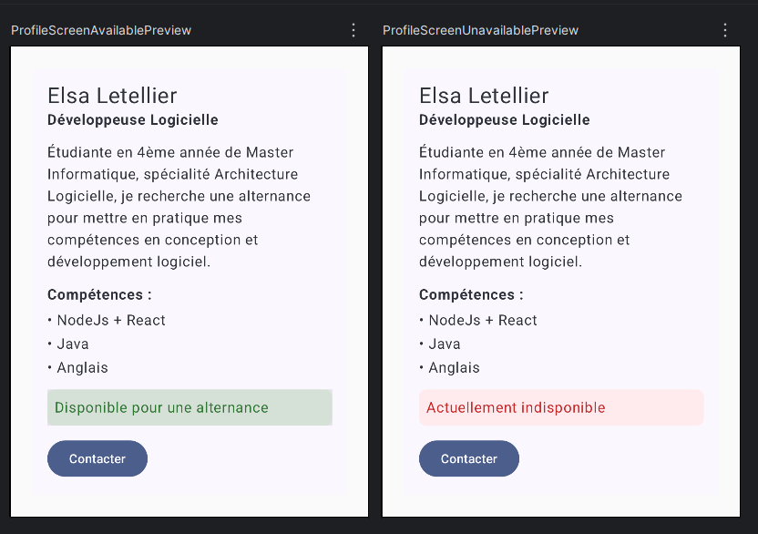

# Profil développeur Compose

## Description courte

Cette application Android affiche un écran unique présentant une fiche de profil développeur.
La fiche contient un nom, un rôle, une courte description, une liste de compétences et une information de disponibilité.
Elle propose deux actions : un bouton "Contacter" et une zone cliquable sur la disponibilité.
Les clics appellent des callbacks vides, l'interface n'est pas modifiée.

## Notions utilisées

- fonctions composables
- paramètres et callbacks
- Modifier et chaînage de modifiers
- padding externe / padding interne
- Surface, Column, Text, Button
- Scaffold et innerPadding
- accessibilité de base (semantics, Role.Button, contentDescription)
- mise en forme du texte (fontSize, fontWeight, color) et background
- previews

## Explication courte

1. Quels composables avez-vous créés ?
ProfileScreen, ProfileCard, ProfileHeader, SkillItem, AvailabilityBanner et ActionButton.

2. Quel composable représente l'écran principal ?
ProfileScreen. C'est lui qui est appelé dans le Scaffold de MainActivity.

3. Où utilisez-vous un padding externe ?
Dans ProfileScreen, avec modifier.padding(24.dp) passé à ProfileCard. C'est le parent qui décide du placement de la fiche dans l'écran.

4. Où utilisez-vous un padding interne ?
Dans ProfileCard, sur la Column placée à l'intérieur de la Surface, avec Modifier.padding(16.dp). Cela espace le contenu de la fiche.

5. Quel composant reçoit un callback ?
ActionButton reçoit onClick, AvailabilityBanner reçoit onClick, et ProfileCard reçoit onContactClick et onAvailabilityClick qu'il transmet. Les composants signalent l'événement, ils ne contiennent aucune logique.

6. Quelle information d'accessibilité avez-vous ajoutée ?
Sur AvailabilityBanner, qui est une zone cliquable personnalisée, j'ai ajouté semantics avec role = Role.Button et un contentDescription décrivant l'action. Un lecteur d'écran annonce donc la zone comme un bouton.

7. Pourquoi vos composants peuvent-ils être considérés comme réutilisables ?
Ils ne contiennent aucune donnée en dur : le texte affiché arrive par paramètres et les actions par callbacks. Chacun accepte aussi modifier: Modifier = Modifier, donc le parent décide du placement. Par exemple ProfileCard espace ses enfants en leur passant un padding, sans modifier leur code. Les deux previews affichent le même profil avec isAvailable à true puis à false : les mêmes composables rendent deux résultats différents.

## Capture

Capture des previews de MainActivity.kt
